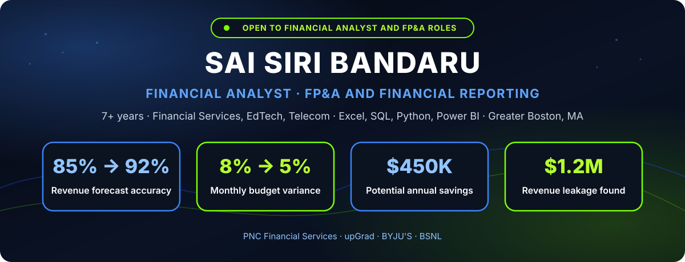

  

Financial Analyst with **7+ years** across Financial Services, EdTech and Telecom, focused on financial reporting, budgeting, forecasting, variance analysis and account reconciliation. Currently in **FP&A and Financial Reporting at PNC Financial Services**. I work in Excel, SQL, Python and Power BI, and I use generative AI for analysis while validating every output against source records.

**Forecast accuracy 85% → 92%** · **Budget variance 8% → 5%** · **$450K potential savings** · **$1.2M revenue leakage found** · **60% less manual reporting time**

---

### ⭐ Featured projects

<table>
<tr>
<td width="33%" valign="top">

**[Three Statement Model](https://github.com/saisiri1207/three-statement-model)** 
Financial modeling

Linked income statement, balance sheet and cash flow. Every shock test keeps the balance check at **0**.

</td>
<td width="33%" valign="top">

**[GL Variance Analysis](https://github.com/saisiri1207/northline-gl-variance)** 
Variance analysis

Operating income **1.8%** below budget, traced to Marketing programs (**+15.8%**) and Travel (**+27.0%**).

 

</td>
<td width="33%" valign="top">

**[Sales Power BI Dashboard](https://github.com/saisiri1207/northline-sales-powerbi-dashboard)** 
Management reporting

**$4.0M** sales over 4,000 transactions with month to date and same period last year views (**+19.8%** YoY).

 

</td>
</tr>
<tr>
<td width="33%" valign="top">

**[Bank Peer Benchmarking](https://github.com/saisiri1207/bank-peer-benchmarking)** 
Real FDIC data

PNC vs 7 regional peers: leads on ROE (**12.6%**) but ranks 5th of 8 on efficiency (**59.2%**).

 

</td>
<td width="33%" valign="top">

**[SEC 10K Peer Analysis](https://github.com/saisiri1207/sec-10k-financial-analysis)** 
Real SEC EDGAR data

Five consumer products companies on growth, margin and cash cycle. P&G operating margin **22.7%**.

 

</td>
<td width="33%" valign="top">

**[Account Reconciliation](https://github.com/saisiri1207/northline-account-reconciliation)** 
Controls and reconciliation

Bank vs GL rules flag duplicates and missing postings. Open exceptions down **67.9%** (184 to 59).

</td>
</tr>
</table>

<b>More projects by area</b>

 

| Area | Projects |
|---|---|
| **Public data forecasting** | [Macro Driver Revenue Forecast](https://github.com/saisiri1207/macro-driver-revenue-forecast) FRED, 98.3% backtest accuracy · [NYC Budget vs Actual](https://github.com/saisiri1207/nyc-budget-vs-actual) $6.99B over adopted budget |
| **Forecasting and planning** | [Fee Income Forecast](https://github.com/saisiri1207/northline-fee-income-forecast) accuracy 85.3% to 92.9% · [Rolling Forecast](https://github.com/saisiri1207/northline-rolling-forecast) · [Scenario Planning](https://github.com/saisiri1207/scenario-planning-pack) · [Headcount Forecast](https://github.com/saisiri1207/headcount-staffing-forecast) · [13 Week Cash Forecast](https://github.com/saisiri1207/thirteen-week-cash-forecast) |
| **Reporting** | [AI Variance Commentary](https://github.com/saisiri1207/northline-variance-commentary-ai) 42 of 42 figures validated · [KPI Scorecard](https://github.com/saisiri1207/monthly-kpi-scorecard) · [Board Flash Report](https://github.com/saisiri1207/board-elt-flash) |
| **Cost, spend and margin** | [Vendor Spend Savings](https://github.com/saisiri1207/northline-vendor-spend) $457K · [Price Elasticity](https://github.com/saisiri1207/northline-price-elasticity) +$852.9K margin · [Margin and Mix Bridge](https://github.com/saisiri1207/margin-mix-bridge) · [Unit Economics](https://github.com/saisiri1207/unit-economics-workbook) · [Cost Accounting](https://github.com/saisiri1207/cost-accounting-workbook) · [Zero Based OpEx Budget](https://github.com/saisiri1207/opex-zbb-pack) |
| **Revenue assurance and close** | [Revenue Assurance](https://github.com/saisiri1207/northline-revenue-assurance) $1.24M leakage · [Month End Close Tracker](https://github.com/saisiri1207/northline-close-tracker) 32 tasks |
| **Valuation and cash** | [DCF Valuation](https://github.com/saisiri1207/dcf-valuation-model) · [Capex Investment Case](https://github.com/saisiri1207/capex-investment-case) · [Working Capital](https://github.com/saisiri1207/working-capital-dashboard) |
| **Customer analytics** | [Churn and Lifetime Value](https://github.com/saisiri1207/northline-churn-clv-finance) $2.01M revenue at risk · [SaaS ARR Bridge](https://github.com/saisiri1207/northline-saas-arr-bridge) |

Northline is a fictional company used for sample data. Real data projects use public FDIC, SEC EDGAR, FRED and NYC Open Data sources. No employer data.

---

### 💼 Experience

**Financial Analyst, FP&A and Financial Reporting** · PNC Financial Services · Cleveland, Ohio (Remote) · Jun 2025 to Present
- Revenue forecast accuracy from **85% to 92%** using revenue, transaction volume, fee income and seasonal trends
- Monthly budget variance from **8% to 5%** across departments and cost centers
- **$450K** potential annual savings from vendor, processing fee and department spend reviews
- SQL reconciliation of transactions vs general ledger cut unresolved exceptions **30%**; report automation cut prep time **60%**

**Financial Analyst** · upGrad · Hyderabad, India · Apr 2022 to Jul 2023
- Enrollment forecast accuracy from **80% to 90%**; lead to enrollment conversion from **8% to 10%** across 100,000 prospects
- Cost per enrolled student down **15%** by tying ad spend, CRM and enrollment data in SQL

**Sales Analyst** · BYJU'S · Vijayawada, India · Aug 2020 to Mar 2022
- Campaign attributed revenue up **12%**; counselor productivity up **20%**
- Automated SQL and Power BI reporting, cutting weekly prep from **10 hours to 3**

**Data Analyst** · BSNL · Hyderabad, India · Sep 2018 to Aug 2019
- Usage vs billing reconciliation found **$1.2M** potential annual revenue leakage
- Monthly churn from **2.8% to 2.4%** across 500,000 subscribers; Python forecasts from **82% to 90%** accuracy

---

### 🧰 Skills

    

**Financial analysis:** financial reporting · variance analysis · budgeting · forecasting · financial modeling · revenue and profitability analysis · expense management · cost optimization 
**Accounting and operations:** general ledger · account reconciliation · management reporting · revenue assurance · billing reconciliation

---

### 🎓 Education

**M.S. Business Analytics**, University of New Haven · Beta Gamma Sigma · 2023 to 2025 
**MBA, Accounting and Finance**, JNTU Kakinada · 2018 to 2020 
**Bachelor's, Accounting and Finance**, Acharya Nagarjuna University · 2015 to 2018

---

**Open to Financial Analyst and FP&A roles** · Greater Boston, MA

  

