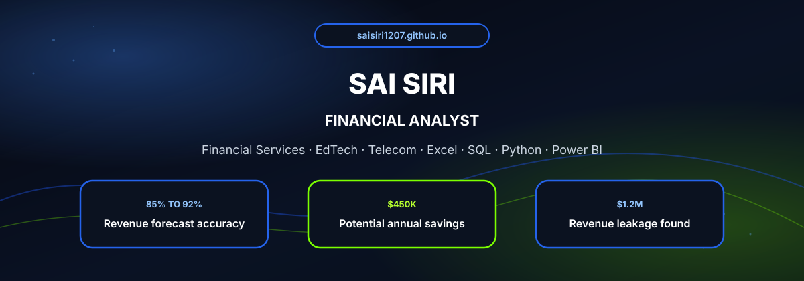
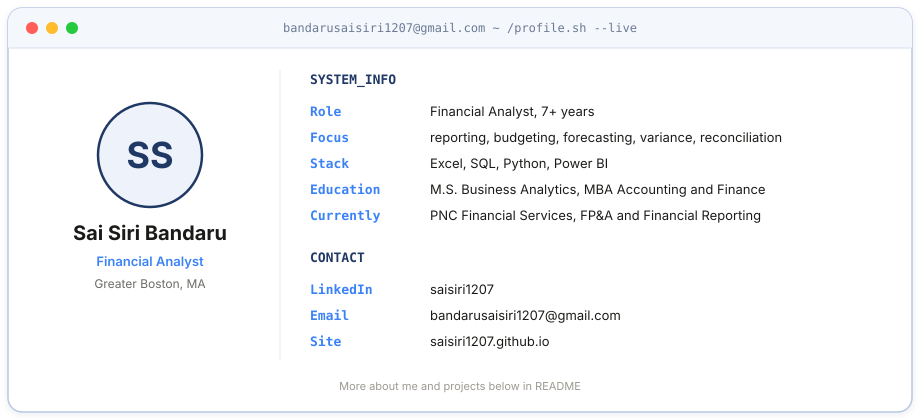
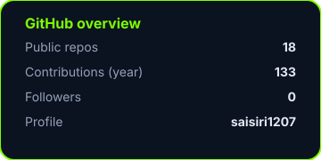
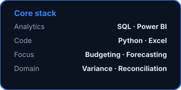

  

 

  

 

### Financial Analyst · Greater Boston, MA

Financial Analyst with 7+ years of experience across Financial Services, the EdTech industry, and the Telecom industry, focused on financial reporting, budgeting, forecasting, variance analysis, and account reconciliation.

---

## At a glance

| Result | Where |
| --- | --- |
| Revenue forecast accuracy improved from **85% to 92%** | PNC Financial Services |
| Monthly budget variance reduced from **8% to 5%** | PNC Financial Services |
| **$450,000** in potential annual savings found | PNC Financial Services |
| **$1.2 million** in potential annual revenue leakage found | BSNL |

I work in SQL, Python, and Power BI, and I apply generative AI tools to analysis and reporting, validating outputs against source records before use.

---

## Featured projects

  
  
  

 

### 1. Three Statement Model
| | |
| --- | --- |
| **What** | A linked income statement, balance sheet and cash flow model, for financial modeling and financial reporting. |
| **Stack** | Excel |
| **Result** | A change in one statement flows through the other two and the books still balance. |
| **Repo** | [three statement model](https://github.com/saisiri1207/three-statement-model) |

### 2. Northline Sales Power BI Dashboard
| | |
| --- | --- |
| **What** | An executive dashboard with KPIs, month to date and same period last year views, for management reporting. |
| **Stack** | Power BI and DAX |
| **Result** | One dashboard replaces scattered tabs, with KPIs, month to date and same period last year views in the same place. |
| **Repo** | [northline sales powerbi dashboard](https://github.com/saisiri1207/northline-sales-powerbi-dashboard) |

### 3. Northline GL Variance
| | |
| --- | --- |
| **What** | Actual vs budget by month, cost center and account, for variance analysis and account reconciliation. |
| **Stack** | Python and SQL |
| **Result** | Variances are ranked by month, cost center and account, so the largest drivers are explained first. |
| **Repo** | [northline gl variance](https://github.com/saisiri1207/northline-gl-variance) |

Northline is a fictional company with sample data. No employer data.

---

## Experience

| Role | Company | Period | Highlights |
| --- | --- | --- | --- |
| Financial Analyst, FP&A and Financial Reporting | PNC Financial Services, Cleveland, Ohio (Remote) | Jun 2025 to Present | Forecast accuracy 85% to 92%, budget variance 8% to 5%, reconciliation exceptions down 30%, reporting prep time down 60%, $450,000 potential annual savings |
| Financial Analyst, EdTech industry | upGrad, Hyderabad, India | Apr 2022 to Jul 2023 | Lead to enrollment conversion 8% to 10% across 100,000 prospective students, cost per enrolled student down 15%, counselor productivity up 20%, forecast accuracy 80% to 90% |
| Sales Analyst, EdTech industry | BYJU'S, Vijayawada, India | Aug 2020 to Mar 2022 | Lead to enrollment conversion 8% to 10%, counselor productivity up 20%, campaign attributed revenue up 12%, weekly reporting 10 hours to 3 hours |
| Data Analyst, Telecom industry | Bharat Sanchar Nigam Limited (BSNL), Hyderabad, India | Sep 2018 to Aug 2019 | Monthly churn 2.8% to 2.4% across 500,000 subscribers, $1.2 million potential annual revenue leakage found, weekly reporting 12 hours to 4 hours, forecast accuracy 82% to 90% |

---

## Core skills

| Area | Skills |
| --- | --- |
| Financial Analysis | Financial Reporting · Variance Analysis · Budgeting · Forecasting · Financial Modeling · Revenue Analysis · Profitability Analysis · Expense Management · Cost Optimization |
| Accounting and Operations | General Ledger · Account Reconciliation · Management Reporting · Revenue Assurance · Billing Reconciliation |
| Analytics and Tools | Excel · SQL · Python · Power BI · CRM Analytics · Churn Analysis · Enrollment and Sales Funnel Analytics · Campaign Performance · Generative AI · Prompt Engineering |

  
  &nbsp;&nbsp;
  

---

## Education

| Degree | School | Period |
| --- | --- | --- |
| M.S., Business Analytics, Beta Gamma Sigma | University of New Haven | Aug 2023 to May 2025 |
| MBA, Accounting and Finance | JNTU Kakinada | Jul 2018 to Dec 2020 |
| Bachelor's, Accounting and Finance | Acharya Nagarjuna University | Aug 2015 to May 2018 |

---

## Contact

  
  
  
  

